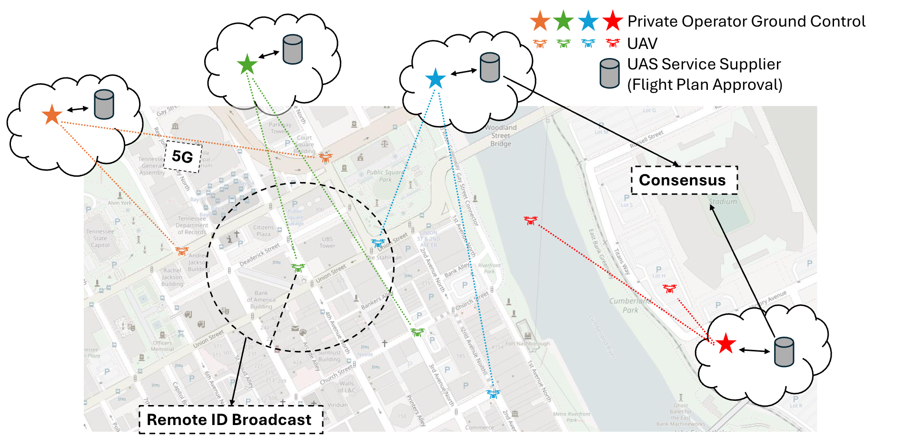
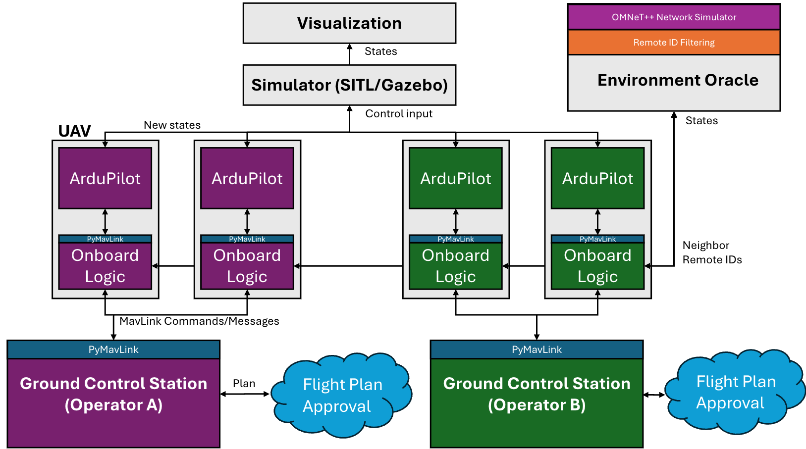
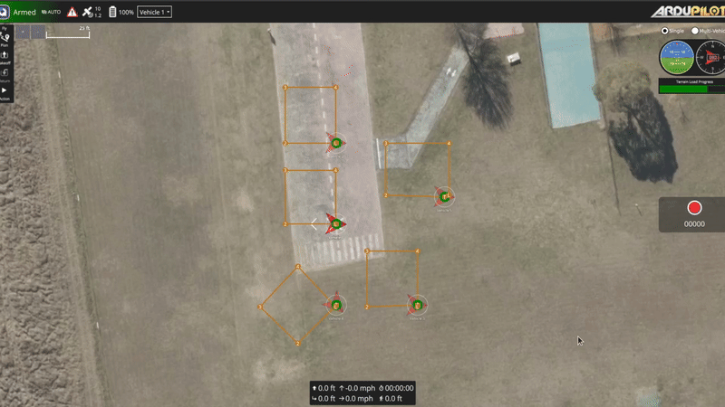

# UAV-CYBER-SIM

## A Networked Multi-UAV Simulation Framework for Coordination and Cybersecurity Research

UAV-CYBER-SIM is a modular, distributed simulator for evaluating coordinated multi-UAV operations, ground control logic, and cybersecurity vulnerabilities. It integrates ArduPilot, Gazebo, QGroundControl, and PyMAVLink to enable realistic mission execution, MAVLink communication, plan approval, and testing of system-level resilience.

---

## About


Unmanned aerial vehicles (UAVs) are expected to play an essential role in the future of air mobility. Small UAVs are already being deployed for tasks such as package delivery, surveillance, and disaster response. These missions increasingly involve complex requirements, including dynamic flight planning, multi-operator coordination, networked communications, and secure operations.

<p align="center">
  
  <br/>
  <em>Example multi-UAV simulation scenario: eight UAVs operated by four private ground stations using MAVLink over 5G. Each UAV broadcasts Remote ID locally and submits its flight plan for external approval and deconfliction.</em>
</p>

To support this evolving ecosystem, UAV-CYBER-SIM offers a comprehensive testbed for simulating and analyzing multi-UAV operations. Each UAV is managed by its own ground control station and follows a pre-approved mission plan, reflecting realistic operator behavior. The simulator also supports remote identification broadcasting, MAVLink message exchange, plan validation workflows, and adversarial testing through cyberattack simulation. This makes it well suited for research in autonomy, communication infrastructure, and secure operations across a wide range of application domains.


---


## Architecture Diagram

<p align="center">
  
  <br/>
  <em>System architecture overview: distributed multi-UAV simulation with separate processes connected via UDP/TCP. Shown for two operators, each managing two UAVs from remote ground control stations.</em>
</p>

---

## Demo Simulation Videos


<div align="center">
  
  <p><em>QGroundControl</em></p>
</div>

<br>

<div align="center">
  
  <p><em>Gazebo</em></p>
</div>


---

## Cyberattack Scenarios

UAV-CYBER-SIM ships a library of adversarial scenarios for studying how multi-UAV
operations fail under attack and how a ground control station (GCS) might detect or
resist them. Each scenario is a runnable notebook; the attack logic lives either in a
Remote ID spoof profile or in a pluggable **man-in-the-middle (MITM) strategy**.

The MITM proxy ([`simulator/mitm.py`](simulator/mitm.py)) is interposed on a vehicle's
GCS↔Logic MAVLink links when its config enables it. A `MITMStrategy`
([`simulator/runtime/mitm/strategies.py`](simulator/runtime/mitm/strategies.py)) decides
what happens to each intercepted message (inspect, modify, drop, or inject) on the
downlink (telemetry to GCS) and uplink (commands to vehicle). This lets an attack sit
transparently between the operator and the drone.

### Attack catalog

| # | Scenario | Attack family | What the attacker does | Notebook(s) |
| :--- | :--- | :--- | :--- | :--- |
| 1 | **Pursuit / interception** | Adversarial autonomy | A hostile UAV chases an evading target in a pursuit-evasion game. | [`7-attack_pursuit`](7-attack_pursuit.ipynb) |
| 2 | **Remote ID spoofing** | Identity / beacon forgery | Broadcasts fabricated Remote ID beacons (fake id, position, or track) into the local RID feed, including a dense city scenario. | [`8-attack_RID_spoofing`](8-attack_RID_spoofing.ipynb), [`8-attack_RID_spoofing_city`](8-attack_RID_spoofing_city.ipynb) |
| 3 | **MITM passthrough** | Baseline / reconnaissance | Interposes on the link but forwards everything unchanged. This proves the tap is transparent and serves as the control case for the attacks below. | [`9-attack_mitm_passthrough`](9-attack_mitm_passthrough.ipynb) |
| 4 | **MITM blackout** | Denial of service | Drops all commands and telemetry, keeping only the keep-alive heartbeat and completion signal so the sim doesn't deadlock. The operator goes blind and loses control. | [`10-attack_mitm_blackout`](10-attack_mitm_blackout.ipynb) |
| 5 | **MITM hijack** | Command injection / takeover | Takes control at a chosen mission point by running a GCS-style intervention from the man-in-the-middle position (switch to GUIDED, fly the attacker's plan); single-vehicle and whole-fleet variants, including a randomized fleet version. | [`11-attack-mitm_hijack`](11-attack-mitm_hijack.ipynb), [`11-attack_mitm_hijack_fleet`](11-attack_mitm_hijack_fleet.ipynb), [`11-attack_mitm_hijack_fleet_random`](11-attack_mitm_hijack_fleet_random.ipynb) |
| 6 | **GCS position spoofing** | False data injection (uplink view) | Injects fake position reports so the GCS sees the drone somewhere it isn't; includes a proximity-triggered variant that fires near a chosen point. | [`12-mitm_spoof_gcs`](12-mitm_spoof_gcs.ipynb), [`12-mitm_spoof_gcs_proximity`](12-mitm_spoof_gcs_proximity.ipynb) |
| 7 | **Hijack → pursuit** | Takeover + weaponization | Hijacks the victim and then steers it to pursue another vehicle, tracking the target via passively overheard Remote ID; single and fleet variants. | [`13-mitm_hijack_pursuit`](13-mitm_hijack_pursuit.ipynb), [`14-mitm_hijack_pursuit_fleet`](14-mitm_hijack_pursuit_fleet.ipynb) |
| 8 | **Stealth hijack** | Takeover + evasion | A hijack that hides the GUIDED mode change from the operator by rewriting downlink heartbeats (and dropping mode-change status text), so the GCS still sees the original mission mode. | [`15-mitm_hijack_stealth`](15-mitm_hijack_stealth.ipynb) |
| 9 | **Ghost-mission / naive data injection** | False data injection (full) | Hijacks the vehicle while fabricating a "mission continues" track: the operator's map shows the drone calmly flying its planned route while it is actually driven elsewhere. | [`16-mitm_naive_data_injection_to_GCS`](16-mitm_naive_data_injection_to_GCS.ipynb) |

### MITM strategy implementations

All MITM attacks are registered `MITMStrategy` subclasses in
[`simulator/runtime/mitm/strategies.py`](simulator/runtime/mitm/strategies.py):

| Strategy class | Role |
| :--- | :--- |
| `PassthroughStrategy` | Transparent tap (baseline). |
| `BlackoutStrategy` | Blinds the operator by dropping all telemetry and commands. |
| `InterventionStrategy` | The core hijack: runs a GCS intervention from the MITM position; `stealth=True` hides the mode change. |
| `HijackPursuitStrategy` | Attacker-driven pursuit; learns the target position via a passive `RIDSniffer`. |
| `SpoofGCSStrategy` / `SpoofOwnerGCSStrategy` | Inject fake position reports toward chosen (or owner) GCSs. |
| `CloakPositionStrategy` | Freezes the GCS's view of the drone at a trigger point (proximity-guard spoof). |
| `GhostMissionStrategy` | Stealth hijack plus a dead-reckoned fake track along the planned route. |
| `StealthModeMask` | Helper that rewrites downlink heartbeats / status text to hide an attacker-induced mode change. |

> **Scope & intent.** These scenarios are for defensive research and education: evaluating
> system-level resilience, detection, and deconfliction for multi-UAV operations. Everything
> runs against ArduPilot SITL inside the simulator; no real aircraft or live radio links are
> involved.

---

## Installation Instructions

### Option 1: Docker (Recommended)

Pull the pre-built image, with ArduPilot SITL, Gazebo, and QGC pre-compiled. See [Docker Setup](docs/installation/docker_setup.md) for full details.

```shell
make pull
make run
```

### Option 2: Local Installation

Install each component natively on Ubuntu:

- [Installing ArduPilot (Ubuntu 20.04)](docs/installation/Installing_Ardupilot_20_04.md): ArduPilot + MAVProxy
- [Installing Gazebo & ArduPilot Plugin](docs/installation/installing_gazebo_arduplugin.md): Gazebo with the ArduPilot bridge plugin
- [Installing QGroundControl](docs/installation/installing_qgc.md): QGC ground control station

### Remote Access

- [Remote Connection](docs/installation/remote_connection.md): connect to a remote Ubuntu server and run GUI apps (Gazebo, QGC) inside Docker via VNC

<!-- ---

## Citation
If you use this simulator, please cite the original paper:

```
@inproceedings{diaz2026uavsim,
  title={Networked Simulation for Cybersecurity Evaluation of Small Unmanned Aircraft Systems in Dense Urban Environments},
  author={Diaz-Gonzalez, Abel and others},
  booktitle={AIAA SciTech 2026},
  year={2026}
}
``` -->

---

## Contact
For questions or collaborations, email [abel.diaz.gonzalez@vanderbilt.edu](mailto:abel.diaz.gonzalez@vanderbilt.edu).
